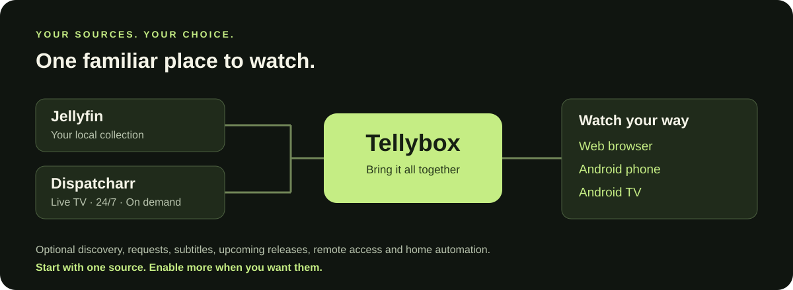
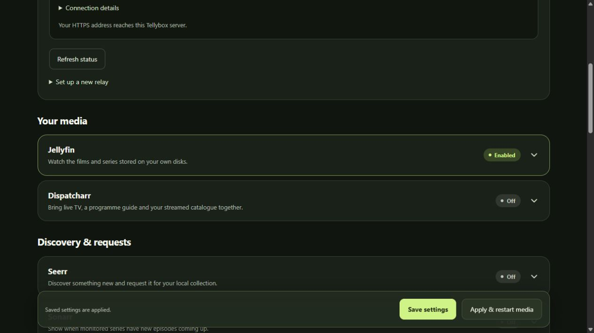

<p align="center">
	
</p>

<h1 align="center">Your sources. One place to watch.</h1>

<p align="center">
	<strong>Merge your local collection, live TV, 24/7 channels and streamed catalogue into one self-hosted viewing experience.</strong>
</p>

<p align="center">
	<a href="https://homelab.tellyboxapp.com/#start">Get started</a> ·
	<a href="https://homelab.tellyboxapp.com/#apps">Get the Android apps</a> ·
	<a href="docs/CHANGELOG.md">What's new</a> ·
	<a href="https://github.com/jharrisuk/tellybox-homelab/issues">Feedback</a>
</p>

**Tellybox HomeLab brings the media services you already run together.** Browse films and series from Jellyfin and Dispatcharr, switch to the TV guide, settle into a 24/7 channel, or discover something new and request it for your collection. Use a web browser, Android phone or Android TV.

**Start small. Enable only what you want.** Every integration is optional and starts switched off. Use just Jellyfin, just Dispatcharr, or bring both together. Add discovery, requests, subtitles, upcoming releases, remote access and home automation when they suit your setup.



## Why Tellybox?

| What you want | What Tellybox brings together |
| --- | --- |
| **One place to choose what to watch** | Local films and series alongside streamed titles, live TV and 24/7 channels. Less switching between service interfaces. |
| **A setup that fits your home** | Optional connections, enabled individually. No requirement to run the whole stack. |
| **The sofa, your phone or a browser** | A web player and official Android phone and TV companion apps connecting to your own server. |
| **Live television and your collection together** | A programme guide, favourites and supported catch-up/recording features through Dispatcharr. |
| **Discovery that leads somewhere** | Browse and search, set your genre preferences, like or dislike titles, and request local copies through Seerr. |
| **A more comfortable episode session** | Resume supported playback, optional next-episode autoplay, subtitle lookup and intro markers. Availability depends on the source and device. |
| **A view of what's coming** | Upcoming monitored episodes and films through Sonarr and Radarr. |
| **Home-only or away from home** | LAN viewing without a public hostname, with an optional authenticated HTTPS relay for remote access. |
| **Useful administration** | Activity information, optional administrator notifications and read-only Home Assistant statistics. |

Tellybox merges the **browsing and viewing experience**; your media stays in its source services. It does not install those services, supply films or channels, or include an IPTV subscription. Connect sources you are entitled to use.

## Connect as much or as little as you like

| Optional connection | What it adds |
| --- | --- |
| **Jellyfin** | Your local films, series and recordings. |
| **Dispatcharr** | Live TV, electronic programme guide (EPG), 24/7 channels, on-demand films and series, and supported recording/catch-up playback. |
| **Seerr** | Discovery and requests for your local collection. |
| **Sonarr / Radarr** | Upcoming releases from the collection you monitor. |
| **OpenSubtitles / IntroDB** | English subtitle lookup and supported intro markers. |
| **Resend / notifications** | Remote email access and optional administrator alerts. |
| **Home Assistant** | Aggregate viewing, transfer and server-health sensors through an optional read-only integration. |
| **HTTPS relay** | An optional authenticated route for watching away from home. |

<details>
<summary><strong>See the optional integration settings</strong></summary>



A real setup screen: each service has its own controls. All integrations start off on a fresh installation.

</details>

## Actively developed, shaped by real use

Tellybox is an **early-access project under active development**, with ongoing fixes, interface improvements and integration work. Follow the [changelog](docs/CHANGELOG.md), [releases](https://github.com/jharrisuk/tellybox-homelab/releases) and [development activity](https://github.com/jharrisuk/tellybox-homelab/commits/main/) to see what has shipped. Server and app versions are independent.

Feedback helps decide what gets improved next. Found a rough edge or have an idea? [Open an issue](https://github.com/jharrisuk/tellybox-homelab/issues). If Tellybox is useful in your homelab, a star or a link helps other people find it.

## Get started

Linux is the recommended server host. Use Windows PowerShell or macOS Terminal to SSH into that Linux server and run the commands there. Windows and Mac can be your management computers; they do not need Docker for this approach. Hosting with Docker Desktop is possible, but the walkthrough uses Linux.

Install Docker Engine with the Compose plugin and Git on the Linux server, then:

```sh
cd ~
git clone https://github.com/jharrisuk/tellybox-homelab.git
cd ~/tellybox-homelab
cp .env.example .env
nano .env
```

In `.env`, set these two values to **your Linux server's private LAN IP**. This example uses `192.168.1.50`; replace it with your own address:

```ini
TELLYBOX_BIND=192.168.1.50
TELLYBOX_SETUP_BIND=192.168.1.50
```

Leave the relay setting unchanged for a home-only setup. Start the server and retrieve the first-setup code:

```sh
docker compose up -d --build --wait
docker compose exec tellybox node -p "require('/config/bootstrap.json').token"
```

From any computer on the same home network, open **`http://SERVER_IP:8990`**. Enter the setup code, choose an installation-administrator password of at least 12 characters, and enable the services you want. Save, test each connection, then apply the settings.

Use **`http://SERVER_IP:8082`** to watch. Setup and local viewing are separate: local viewing does not grant installation-administrator access. Keep ports 8082 and 8990 off the public internet. See the [walkthrough](https://homelab.tellyboxapp.com/#start) for the full network settings, same-server connections and troubleshooting.

## Phone and TV apps

Download the latest official **Tellybox HomeLab** apps from the [guide](https://homelab.tellyboxapp.com/#apps) and enter your own server address. App and server version numbers are independent.

The apps are proprietary and their source is not in this repository. Their signed updates come from the Tellybox publisher, regardless of which media server you connect to. You do not need to build apps or host APK files. The phone app can also guide you through installing the TV app over your local network on compatible devices.

## Home Assistant

An optional read-only Home Assistant custom integration is in `integrations/home-assistant`. It exposes aggregate stream, download, upload and server health sensors. Copy `custom_components/tellybox` into your Home Assistant configuration and follow the [integration README](integrations/home-assistant/README.md). It is not an official Home Assistant integration and is not listed in HACS. The Tellybox server side stays disabled until you create a dedicated token in installation settings.

## Remote viewing and notifications

Home-only use needs no public hostname. For remote viewing, follow the [optional HTTPS relay guide](https://homelab.tellyboxapp.com/#remote). A relay connects to the server's authenticated **8083** entry; do not expose the login-free local viewing port instead.

Administrator notifications are optional. The **Standard Tellybox HomeLab** setting uses the shared notification gateway and Google Firebase Cloud Messaging to wake an opted-in administrator's app. Notification details are fetched from your own server after authentication. See [Privacy and data flow](docs/PRIVACY.md).

## Updates and backups

Back up the configuration volume, `.env` and source revision first. The configuration contains credentials, so encrypt backups and keep them private. Choose a time when a brief playback interruption is acceptable, then run in the original project folder:

```sh
git status --short
git pull --ff-only
docker compose up -d --build --wait
```

Stop if Git reports conflicts or unexpected local changes. Keep your existing `.env` and configuration volume; do not replace them with a fresh example. Never use `docker compose down -v` to update: it removes the configuration volume. Media remains in its source services, which need their own backups.

## Licence

The Tellybox server and web interface are **source-available under [PolyForm Noncommercial 1.0.0](LICENSE)**. Personal and other permitted non-commercial use, modification and sharing are allowed. Commercial use needs separate permission. This is not an open-source licence.

Official companion apps are covered separately by [App terms](APP-TERMS.md). Third-party components retain their own licences, and metadata, artwork and connected services have their own terms.

## Feedback

This is an early-access hobby project. Device compatibility, playback and third-party features depend on your setup. [Open an issue](https://github.com/jharrisuk/tellybox-homelab/issues) with your server version, app version, device and a short description of what happened. Remove passwords, setup codes, API keys, email addresses, private media URLs and other personal details from screenshots or logs before posting.
